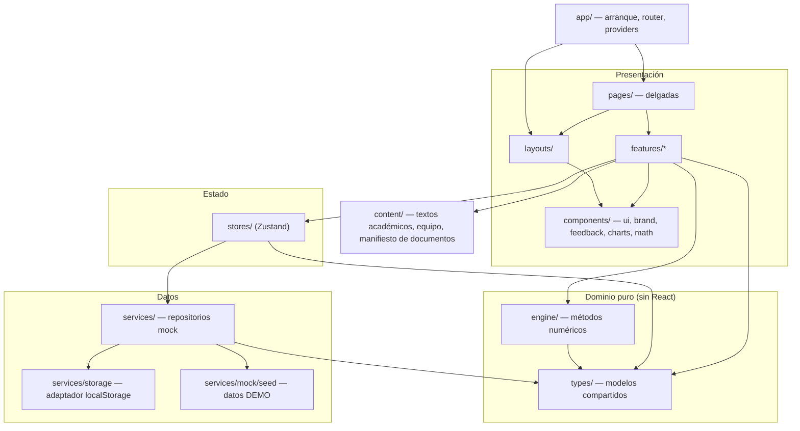
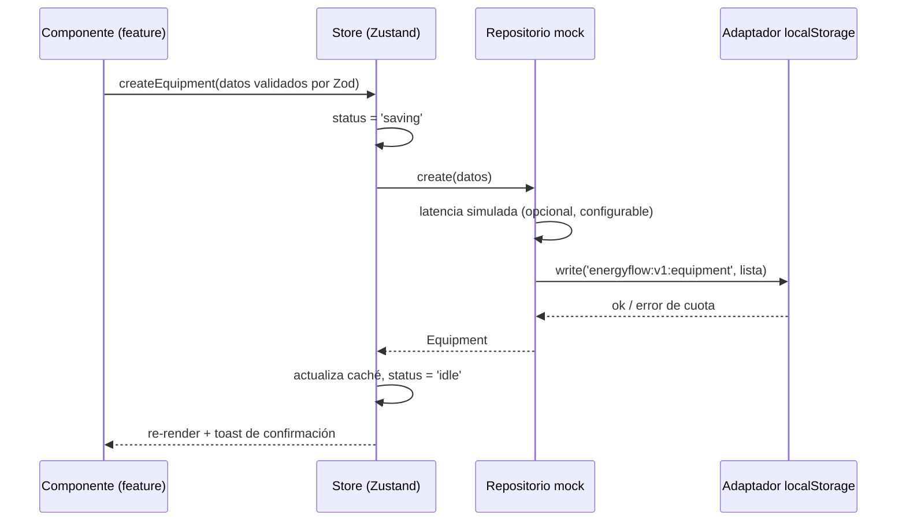
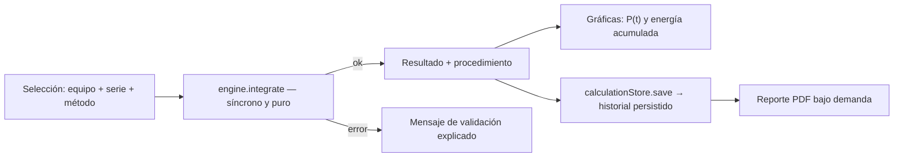

# EnergyFlow — Arquitectura

> "La energía también se puede calcular."
> Documento de referencia aprobado en la **Fase 1**. Cualquier cambio posterior
> debe justificarse y aprobarse antes de aplicarse.

---

## 1. Visión general

EnergyFlow es una **SPA (Single Page Application)** construida con React + TypeScript + Vite.
No existe backend: la persistencia se realiza en el navegador (`localStorage`) a través de
una capa de servicios simulados. Los cálculos numéricos son **reales** y viven en un motor
matemático independiente de React.

La aplicación tiene dos áreas con layouts, navegación y carga independientes:

| Área              | Ruta base | Propósito                                     |
| ----------------- | --------- | --------------------------------------------- |
| Landing académica | `/`       | Presentar el proyecto, documentación y equipo |
| Demo del sistema  | `/demo/*` | Aplicación interactiva de monitoreo y cálculo |

### Stack (versiones verificadas en Fase 0)

| Capa               | Tecnología                                                              |
| ------------------ | ----------------------------------------------------------------------- |
| Build / dev server | Vite 8 + `@vitejs/plugin-react`                                         |
| UI                 | React 19, TypeScript **6.0.3** (fijado: TS 7 rompe `typescript-eslint`) |
| Estilos            | Tailwind CSS 4 (`@theme` + variables CSS)                               |
| Componentes        | shadcn/ui (código copiado al repo) sobre Radix UI, iconos Lucide        |
| Rutas              | React Router 8 (modo _data_: `createBrowserRouter`)                     |
| Estado             | Zustand 5                                                               |
| Formularios        | React Hook Form + Zod 4 (`@hookform/resolvers`)                         |
| Gráficas           | Recharts 3                                                              |
| Utilidades         | date-fns 4 (locale `es`), Papa Parse 5 (CSV), jsPDF 4 (reportes)        |
| Pruebas            | Vitest 5 (+ jsdom y Testing Library para componentes)                   |

---

## 2. Diagrama de arquitectura

### 2.1 Capas y dirección de dependencias

Las flechas indican "puede importar a". Ninguna capa inferior importa a una superior.



### 2.2 Reglas de frontera (se harán cumplir con ESLint `no-restricted-imports` en Fase 2)

| Módulo        | Puede importar                                             | **No** puede importar                                         |
| ------------- | ---------------------------------------------------------- | ------------------------------------------------------------- |
| `engine/`     | solo `engine/` y `types/`                                  | React, `stores/`, `services/`, `components/`, librerías de UI |
| `services/`   | `types/`, `utils/`, `services/`                            | React, `stores/`, `components/`, `features/`                  |
| `stores/`     | `services/`, `types/`, `utils/`                            | `components/`, `features/`, `pages/`                          |
| `components/` | `components/`, `hooks/`, `utils/`, `types/`                | `features/`, `stores/`, `pages/`                              |
| `features/X`  | todo lo anterior + `features/Y` **solo por su `index.ts`** | internos de otra feature                                      |
| `pages/`      | `features/`, `layouts/`, `components/`                     | `services/` directamente                                      |
| `content/`    | solo `types/`                                              | todo lo demás (es solo datos editables)                       |

---

## 3. Árbol de carpetas

```text
energyflow-web/
├── docs/
│   └── ARCHITECTURE.md            # este documento
├── public/
│   ├── documents/                 # PDFs académicos reales (informe, diapositivas)
│   ├── images/
│   │   ├── team/                  # fotografías de integrantes (cuando se entreguen)
│   │   └── og/                    # imagen para compartir (Open Graph)
│   ├── logos/                     # logo EnergyFlow (SVG) y variantes
│   └── favicon.svg
├── src/
│   ├── app/
│   │   ├── main.tsx               # punto de entrada (monta <App/>)
│   │   ├── App.tsx                # composición de providers + RouterProvider
│   │   ├── router.tsx             # árbol de rutas (lazy)
│   │   ├── paths.ts               # constantes de rutas (única fuente de verdad)
│   │   └── providers/             # ThemeProvider, Toaster
│   ├── components/
│   │   ├── ui/                    # primitivos shadcn/ui adaptados (Button, Input, Card, Dialog, Table…)
│   │   ├── brand/                 # Logo, Wordmark
│   │   ├── feedback/              # EmptyState, ErrorState, LoadingState, DemoDataBadge, PlaceholderNotice
│   │   ├── charts/                # ChartContainer, tema de colores para Recharts
│   │   └── math/                  # Formula, Fraction, Integral (render tipográfico de fórmulas)
│   ├── layouts/
│   │   ├── LandingLayout/         # header público + footer
│   │   └── DashboardLayout/       # Sidebar, Header, Breadcrumbs, MobileNav
│   ├── pages/
│   │   ├── landing/               # HomePage, DocumentViewerPage
│   │   ├── demo/                  # DashboardPage, EquipmentPage, MeasurementsPage, CalculatorPage,
│   │   │                          # AnalysisPage, HistoryPage, ReportsPage (+ páginas de detalle)
│   │   └── system/                # NotFoundPage, RouteErrorPage
│   ├── features/
│   │   ├── landing/               # secciones: Hero, About, Problem, Objectives, Justification,
│   │   │                          # Methodology, Documents, Team, DemoAccess
│   │   ├── documents/             # DocumentCard, PdfViewer, estado "no disponible"
│   │   ├── dashboard/             # KPIs, resumen, gráficas de resumen
│   │   ├── equipment/             # components/, schemas.ts, hooks/, index.ts
│   │   ├── measurements/          # components/, schemas.ts, csv/, hooks/, index.ts
│   │   ├── calculator/            # selección, ejecución, procedimiento paso a paso
│   │   ├── analysis/              # comparación de métodos, errores, gráficas
│   │   ├── history/               # listado y detalle de cálculos
│   │   └── reports/               # construcción de PDF (jsPDF, carga diferida)
│   ├── engine/
│   │   ├── methods/               # trapezoid.ts, simpson13.ts, simpson38.ts
│   │   ├── validation.ts          # orden, duplicados, uniformidad, paridad, múltiplo de 3
│   │   ├── units.ts               # conversión de tiempo/potencia/energía
│   │   ├── procedure.ts           # generación de pasos, fórmula y sustituciones
│   │   ├── reference/             # funciones de referencia con integral exacta conocida
│   │   ├── errors.ts              # tipos de error del motor
│   │   ├── types.ts
│   │   └── index.ts               # API pública del motor
│   ├── services/
│   │   ├── storage/               # adaptador localStorage versionado y tolerante a fallos
│   │   ├── repositories/          # interfaces + implementaciones mock (equipment, measurements, calculations)
│   │   ├── mock/
│   │   │   ├── latency.ts         # retardo simulado opcional
│   │   │   └── seed/              # DATOS DE DEMOSTRACIÓN (marcados origin: 'demo')
│   │   └── index.ts               # registro de servicios (inyección simple)
│   ├── stores/                    # equipmentStore, measurementStore, calculationStore, uiStore
│   ├── content/                   # project.ts, team.ts, documents.ts (editables; placeholders marcados)
│   ├── hooks/                     # hooks genéricos: useMediaQuery, useDocumentTitle, useTheme…
│   ├── types/                     # modelos de dominio compartidos
│   ├── utils/                     # cn(), formato numérico/fechas (es), ids, constantes
│   ├── styles/
│   │   └── globals.css            # tokens (@theme), modo claro/oscuro, base
│   └── tests/
│       ├── setup.ts               # configuración global de Vitest
│       ├── helpers/               # renderWithRouter, storage en memoria
│       └── flows/                 # pruebas de flujos completos (integración)
├── .gitattributes                 # eol=lf (el equipo usa Windows con autocrlf)
├── components.json                # configuración shadcn/ui
├── eslint.config.js
├── .prettierrc
├── index.html
├── package.json
├── tsconfig*.json
├── netlify.toml                   # build, rewrite SPA → index.html, caché de assets
└── vite.config.ts                 # incluye configuración de Vitest
```

### Ajustes respecto a la estructura sugerida

| Cambio                             | Motivo                                                                                                                                                |
| ---------------------------------- | ----------------------------------------------------------------------------------------------------------------------------------------------------- |
| **+ `content/`**                   | Centraliza todo el texto académico, integrantes y metadatos de documentos. El equipo edita un solo lugar al final del proyecto sin tocar componentes. |
| **+ `styles/`**                    | Tailwind v4 define los tokens en CSS; necesita un archivo global propio.                                                                              |
| **`services/mock/seed/`**          | Separa físicamente los datos de demostración de la lógica, como exige el estándar de calidad.                                                         |
| **`utils/` en lugar de `lib/`**    | Se respeta la estructura pedida; shadcn se configurará con alias `@/utils/cn`.                                                                        |
| **Pruebas co-ubicadas + `tests/`** | Las pruebas unitarias viven junto al código (`trapezoid.test.ts`); `tests/` contiene setup, helpers y flujos.                                         |

---

## 4. Responsabilidad de cada directorio

| Directorio            | Responsabilidad                                                             | Ejemplo                          |
| --------------------- | --------------------------------------------------------------------------- | -------------------------------- |
| `app/`                | Arranque, providers globales, definición de rutas                           | `router.tsx`                     |
| `components/ui`       | Primitivos visuales sin lógica de negocio                                   | `Button`, `Dialog`               |
| `components/feedback` | Estados transversales: vacío, carga, error, aviso de datos demo             | `EmptyState`                     |
| `components/math`     | Representación tipográfica de fórmulas (sin dependencias extra)             | `<Integral from="a" to="b">`     |
| `layouts/`            | Estructura de página (marcos), sin datos de dominio                         | `DashboardLayout`                |
| `pages/`              | Componen features para una ruta. Delgadas: sin lógica propia                | `CalculatorPage`                 |
| `features/`           | Funcionalidad completa de un dominio: componentes, esquemas Zod, hooks      | `equipment/`                     |
| `engine/`             | Matemática pura, determinista y testeable sin DOM                           | `simpson13(points)`              |
| `services/`           | Acceso a datos tras interfaces; hoy localStorage, mañana podría ser una API | `EquipmentRepository`            |
| `stores/`             | Estado de la aplicación en memoria y orquestación de servicios              | `useEquipmentStore`              |
| `content/`            | Información académica editable (con banderas `placeholder`)                 | `team.ts`                        |
| `hooks/`              | Hooks reutilizables no ligados a un dominio                                 | `useMediaQuery`                  |
| `types/`              | Tipos de dominio compartidos entre capas                                    | `Equipment`, `MeasurementSeries` |
| `utils/`              | Funciones puras pequeñas y constantes                                       | `formatEnergy()`                 |

---

## 5. Modelo de dominio

```ts
type DataOrigin = 'demo' | 'manual' | 'csv';
type TimeUnit = 's' | 'min' | 'h';
type PowerUnit = 'W' | 'kW';
type IntegrationMethod = 'trapezoid' | 'simpson13' | 'simpson38';

interface Equipment {
  id: string;
  name: string;
  category: EquipmentCategory; // iluminación, climatización, cómputo, cocina, motor, otro
  ratedPowerW: number; // potencia nominal (> 0)
  location?: string;
  description?: string;
  origin: DataOrigin;
  createdAt: string; // ISO 8601
  updatedAt: string;
}

/** Una serie es un conjunto ordenado de muestras P(t) de un equipo. Es la unidad que se integra. */
interface MeasurementSeries {
  id: string;
  equipmentId: string;
  name: string;
  timeUnit: TimeUnit;
  powerUnit: PowerUnit;
  samples: { t: number; p: number }[]; // t estrictamente creciente, p >= 0
  origin: DataOrigin;
  recordedAt: string;
  createdAt: string;
  updatedAt: string;
}

/** Instantánea inmutable: sobrevive aunque se borre el equipo o la serie. */
interface CalculationRecord {
  id: string;
  createdAt: string;
  method: IntegrationMethod;
  equipment: { id: string; name: string };
  series: {
    id: string;
    name: string;
    origin: DataOrigin;
    timeUnit: TimeUnit;
    powerUnit: PowerUnit;
  };
  input: { t: number; p: number }[];
  result: IntegrationResult; // producido por engine/
  reference?: { label: string; exactWh: number }; // solo si hay función con integral exacta
}
```

**Decisión clave — "serie de mediciones":** una integral se calcula sobre un conjunto
contiguo de puntos, no sobre mediciones sueltas. Por eso las mediciones se agrupan en
**series** por equipo. Dentro de una serie se pueden agregar, editar y eliminar muestras
individuales; el origen (`demo`, `manual`, `csv`) queda registrado en la serie.

---

## 6. Motor matemático (`engine/`)

### API pública prevista

```ts
integrate(input: IntegrationInput, method: IntegrationMethod): EngineResult<IntegrationResult>
compareMethods(input: IntegrationInput, reference?: ExactReference): MethodComparison
```

- **Funciones puras**, sin efectos ni excepciones de control de flujo: devuelven un
  resultado discriminado `{ ok: true, value } | { ok: false, error }` con códigos de error
  tipados (`NOT_ENOUGH_POINTS`, `NON_UNIFORM_SPACING`, `SIMPSON13_REQUIRES_EVEN`,
  `SIMPSON38_REQUIRES_MULTIPLE_OF_3`, `NEGATIVE_POWER`, `UNSORTED_TIME`, …).
- **Unidades:** el motor normaliza internamente a P en **W** y t en **h**, por lo que
  ∫P dt queda en **Wh**. Si el tiempo está en segundos, el procedimiento muestra el factor
  explícito `E = (1/3600) ∫ P(t) dt`. Se reporta también en kWh.
- **Uniformidad:** el trapecio admite pasos no uniformes (suma de trapecios individuales).
  Simpson 1/3 y 3/8 exigen `h` constante (tolerancia relativa `1e-9`); si no se cumple,
  el motor rechaza el cálculo con explicación, **nunca** produce un valor engañoso.
- **Procedimiento:** cada resultado incluye la fórmula general, `n`, `h`, la tabla de
  coeficientes, la sustitución numérica y el resultado con unidades, como datos
  estructurados que la UI y el PDF representan.
- **Errores numéricos:** el error absoluto y el relativo (%) solo se calculan frente a una
  **integral exacta conocida** (funciones de `engine/reference/`, p. ej. `P(t)=100+20t` en
  [0,2] h → 240 Wh). Con datos medidos se muestra la **diferencia entre métodos**,
  rotulada como tal.

---

## 7. Flujo de datos

### 7.1 Lectura y escritura (CRUD)



### 7.2 Cálculo



### 7.3 Persistencia local

- Claves con espacio de nombres y versión: `energyflow:v1:equipment`,
  `energyflow:v1:measurements`, `energyflow:v1:calculations`, `energyflow:theme`.
- **Validación al leer** con Zod: si los datos están corruptos o son de otra versión, se
  descartan con un aviso y se restauran los datos semilla.
- **Primera visita:** se cargan los datos de demostración (`origin: 'demo'`), que se
  identifican visualmente con una insignia "Datos de demostración".
- **"Reiniciar demo":** borra las claves `v1` y vuelve a sembrar.
- Si `localStorage` no está disponible (modo privado estricto), se usa almacenamiento en
  memoria y se informa al usuario de que los cambios no persistirán.

### 7.4 Gestión del estado

| Store              | Contenido                                                   |
| ------------------ | ----------------------------------------------------------- |
| `equipmentStore`   | lista, estado de carga/error, acciones CRUD                 |
| `measurementStore` | series, filtros, CRUD de series y muestras, importación CSV |
| `calculationStore` | historial de cálculos                                       |
| `uiStore`          | sidebar colapsado/abierto en móvil                          |

El **tema** no vive en un store: lo gestiona `ThemeProvider` (contexto de React) desde la
Fase 3, porque debe existir antes que la demo y no depende de Zustand (ver D13).

El estado efímero (formularios, diálogos abiertos, selección de la calculadora) vive en el
componente o en React Hook Form, no en stores globales.

---

## 8. Estrategia de navegación

```text
/                                Landing (secciones con anclas)
  #proyecto #problema #objetivos #justificacion #metodologia #documentos #equipo #demo
/documentos/:slug                Visor de PDF (informe | diapositivas)
/demo                            → redirige a /demo/dashboard
/demo/dashboard                  Resumen e indicadores
/demo/equipos                    Listado + CRUD
/demo/equipos/:equipmentId       Detalle de equipo
/demo/mediciones                 Series de mediciones + importación CSV
/demo/calculadora                Cálculo con un método y procedimiento
/demo/analisis                   Comparación de métodos y errores
/demo/historial                  Historial de cálculos
/demo/historial/:calculationId   Detalle de un cálculo
/demo/reportes                   Generación de reportes PDF
*                                404
```

- **Rutas con carga diferida** (`lazy`): la landing no descarga Recharts, jsPDF ni
  Papa Parse. jsPDF y Papa Parse se importan dinámicamente solo al exportar o importar.
- **Breadcrumbs** derivados del `handle` de cada ruta (sin duplicar configuración).
- **`paths.ts`** es la única fuente de rutas: ningún componente escribe una URL literal.
- **Errores de ruta:** `errorElement` por área (landing y demo) con opción de volver.
- **Restauración de scroll** y desplazamiento suave a anclas en la landing.
- **Netlify:** `netlify.toml` reescribe (status 200) todas las rutas sin archivo estático a
  `index.html`, de modo que recargar `/demo/calculadora` no devuelve 404.

---

## 9. Sistema de diseño

- **Tokens** en `styles/globals.css` mediante `@theme` de Tailwind v4.
  - Paleta base: Navy `#071426`, Dark Blue `#0B2342`, Electric Blue `#1677FF`,
    Cyan `#16C8E8`, White `#F5F8FC`.
  - Tokens **semánticos** (`--background`, `--surface`, `--primary`, `--accent`,
    `--border`, `--muted`, `--success`, `--warning`, `--danger`), que son los que usan
    los componentes. Nunca se usan valores hexadecimales en los componentes.
  - Paleta de gráficas propia, con contraste verificado en ambos temas (se define en la
    Fase 10 junto con `components/charts`).
  - Guía completa y contrastes verificados: [DESIGN_SYSTEM.md](DESIGN_SYSTEM.md).
- **Temas:** claro y oscuro con variables CSS. La landing es _dark-first_ (estética
  navy/eléctrica). En la demo el usuario elige el tema, que respeta `prefers-color-scheme`
  y se recuerda en `localStorage`.
- **Tipografía:** Space Grotesk (títulos), Inter (interfaz) y JetBrains Mono (cifras y
  fórmulas), autoalojadas mediante `@fontsource-variable`.
- **Componentes:** patrón shadcn/ui (código propio en `components/ui`, variantes con `cva`)
  sobre primitivas de Radix (`radix-ui`), reestilizados a la identidad EnergyFlow.
  Accesibilidad heredada de Radix (foco, teclado, ARIA). Notificaciones con `sonner`
  detrás de la API propia `notify`.
- **Movimiento:** transiciones CSS breves (150–300 ms) y respeto de
  `prefers-reduced-motion`. No se añade librería de animación.
- **Fórmulas:** componentes propios en `components/math` con HTML y Unicode. Se evita
  KaTeX (~280 KB). Si en la Fase 9 o 10 resultara insuficiente, se propondrá antes de
  instalarlo.

---

## 10. Documentos académicos

- Los PDFs reales se colocan en `public/documents/` y se describen en `content/documents.ts`:

```ts
{ slug: 'informe', title: 'Informe final', file: '/documents/informe.pdf',
  pages?: number, sizeKb?: number, updatedAt?: string, available: boolean }
```

- `available: false` → tarjeta con el estado "Documento aún no disponible", sin enlaces rotos.
- Visualización con el visor nativo del navegador (`<iframe>`/`<object>`) y botón de
  descarga. Se evita pdf.js para no añadir ~1 MB al bundle. En móviles, donde el visor
  embebido es limitado, se ofrece abrir el PDF en una pestaña nueva.

---

## 11. Estrategia de pruebas

| Nivel       | Ámbito                                                                              | Entorno                    | Prioridad                                 |
| ----------- | ----------------------------------------------------------------------------------- | -------------------------- | ----------------------------------------- |
| Unitarias   | `engine/` (métodos, validaciones, unidades, referencias exactas)                    | node                       | **Máxima** (objetivo ≥ 95 % de cobertura) |
| Unitarias   | Esquemas Zod, parser CSV, utilidades de formato                                     | node                       | Alta                                      |
| Integración | Repositorios + adaptador de storage (CRUD, persistencia, datos corruptos, reinicio) | jsdom / storage en memoria | Alta                                      |
| Componentes | Formularios con validación, importación CSV, calculadora                            | jsdom + Testing Library    | Media                                     |
| Flujos      | Crear equipo → registrar serie → calcular → ver en historial                        | jsdom                      | Media                                     |
| Manual      | Responsive, contraste, teclado, PDFs generados                                      | navegador                  | Fase 12                                   |

Casos matemáticos de referencia (integral exacta conocida):

| Función           | Intervalo | Exacta   | Propiedad esperada                                         |
| ----------------- | --------- | -------- | ---------------------------------------------------------- |
| `100 + 20t`       | [0, 2] h  | 240 Wh   | Los tres métodos son exactos (lineal)                      |
| `t²`, `t³`        | [0, 3]    | 9, 20.25 | Simpson 1/3 y 3/8 son exactos hasta grado 3                |
| `sin t`           | [0, π]    | 2        | El error disminuye al aumentar `n` (orden de convergencia) |
| Datos en segundos | —         | —        | Aplica el factor 1/3600 → Wh                               |

Scripts previstos: `dev`, `build`, `preview`, `typecheck`, `lint`, `format`, `test`,
`test:watch` y `test:coverage`.

---

## 12. Decisiones técnicas (resumen)

| #   | Decisión                                                                | Alternativa descartada            | Motivo                                                                                                                                       |
| --- | ----------------------------------------------------------------------- | --------------------------------- | -------------------------------------------------------------------------------------------------------------------------------------------- |
| D1  | TypeScript 6.0.3 fijado                                                 | TS 7.0.2                          | `typescript-eslint` exige `<6.1.0`                                                                                                           |
| D2  | SPA con dos árboles de rutas y carga diferida                           | Dos apps o un monorepo            | Simplicidad; aislamiento suficiente con layouts y lazy loading                                                                               |
| D3  | Repositorios con interfaz + Zustand como caché                          | `persist` de Zustand directamente | Capa de servicios explícita, testeable y sustituible por una API real                                                                        |
| D4  | Motor puro con resultados discriminados                                 | Lanzar excepciones                | Errores tipados y explicables en la UI y en las pruebas                                                                                      |
| D5  | Series de mediciones como unidad integrable                             | Mediciones sueltas                | Una integral numérica requiere un conjunto ordenado de puntos                                                                                |
| D6  | Error solo frente a una integral exacta                                 | "Error" contra otro método        | Evita presentar como error algo que no lo es                                                                                                 |
| D7  | Visor PDF nativo                                                        | pdf.js                            | Peso del bundle; suficiente para el caso de uso                                                                                              |
| D8  | Fórmulas con componentes propios                                        | KaTeX                             | Peso; se reevaluará en la Fase 9 o 10                                                                                                        |
| D9  | `content/` centralizado con placeholders                                | Texto dentro de componentes       | El equipo cargará la información real al final                                                                                               |
| D10 | Snapshot inmutable en el historial                                      | Referencias por id                | El historial no se rompe si se elimina el equipo o la serie                                                                                  |
| D11 | `.gitattributes` con `eol=lf`                                           | Dejar el `autocrlf` por defecto   | Evita conflictos de Prettier y diffs ruidosos en Windows                                                                                     |
| D12 | Despliegue en Netlify (`netlify.toml`)                                  | Vercel                            | Elección del equipo (Fase 2); configuración versionada en el repositorio                                                                     |
| D13 | Tema en `ThemeProvider` (contexto)                                      | Tema en `uiStore` (Zustand)       | Se necesita desde la Fase 3 en landing y demo; no requiere Zustand                                                                           |
| D14 | `NativeSelect` (`<select>` estilizado)                                  | Radix Select                      | Accesible por defecto, interfaz nativa en móvil, integración directa con React Hook Form                                                     |
| D15 | Notificaciones con `sonner` detrás de `notify`                          | Radix Toast                       | API imperativa invocable tras cualquier acción; la librería se puede sustituir sin tocar las features                                        |
| D16 | Catálogo `/design-system` solo en desarrollo                            | Storybook                         | Cero dependencias extra; se elimina del build de producción                                                                                  |
| D17 | Borradores marcados (`draft: true` → insignia "Borrador")               | Texto genérico o secciones vacías | Problema, objetivos y justificación se redactan solo a partir de la definición del proyecto, sin cifras; el equipo los valida con su informe |
| D18 | Sección Demo sin enlace hasta la Fase 6                                 | Botón hacia `/demo`               | Evita enlaces rotos mientras la demo no existe                                                                                               |
| D19 | `RootLayout` con `ScrollRestoration` + `HydrateFallback`                | Lógica propia de scroll a anclas  | React Router desplaza a `#ancla` y restaura la posición; el fallback muestra carga mientras llegan los módulos lazy                          |
| D20 | Verificar el PDF con `HEAD` + `Content-Type` antes de incrustarlo       | Confiar en el código HTTP         | Vite y la reescritura SPA de Netlify responden 200 con `index.html` para archivos inexistentes                                               |
| D21 | Pruebas `*.node.test.ts` con su propia configuración TS (tipos de Node) | Añadir tipos de Node a todo `src` | Comprueban archivos reales de `public/` sin filtrar APIs de Node al código del navegador                                                     |
